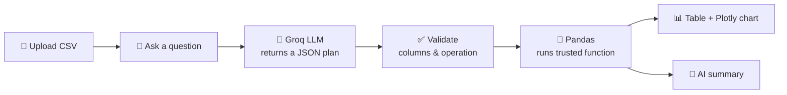

<div align="center">

# 📊 AI Data Analyst

### Ask questions about your data in plain English. Get tables, charts and insights instantly.

[](https://ai-data-analyst-5fqwczcbn69laqysefhymr.streamlit.app/)


**🔗 Live app: [ai-data-analyst-5fqwczcbn69laqysefhymr.streamlit.app](https://ai-data-analyst-5fqwczcbn69laqysefhymr.streamlit.app/)**

</div>

---

## ✨ Overview

**AI Data Analyst** lets anyone analyze a CSV file without writing code or formulas. Upload a dataset, type a question such as *"Show the monthly revenue trend"*, and the app returns a result table, an interactive chart and a short plain-English summary.

> **Design principle:** the AI *plans*, Pandas *calculates*. The language model never writes or runs code, so every number comes from trusted, tested functions.

## 🚀 Features

| Feature | Description |
|---|---|
| 💬 **Natural-language questions** | Ask in everyday English, no SQL or Excel needed |
| 📂 **CSV upload** | Works with your own data, or load the built-in sample |
| 📈 **Interactive charts** | Plotly bar, line, box and histogram charts with hover and zoom |
| 🔍 **Anomaly detection** | Flags outliers using z-scores |
| 📉 **Trend analysis** | Monthly, weekly, quarterly or yearly trends with a trend line |
| 🧾 **Plain-English summary** | The AI explains the computed result in 2–3 sentences |
| 🔒 **Safe by design** | No arbitrary code execution; columns and operations are validated |

## 🧠 How It Works



1. **Plan:** the LLM receives only the column names and a few sample rows, and replies with a JSON plan, for example:
   ```json
   {"operation": "sum", "group_column": "region", "value_column": "revenue"}
   ```
2. **Validate:** the plan is checked against the real columns and the allowed operations.
3. **Compute:** Pandas runs the matching function in `analysis.py`.
4. **Present:** Streamlit shows the table and chart, and the LLM summarizes the computed result.

## 🛠️ Tech Stack

| Layer | Tool |
|---|---|
| Interface | Streamlit |
| Calculations | Pandas |
| Charts | Plotly |
| LLM | Groq (open-source Llama / GPT-OSS models) |
| Hosting | Streamlit Community Cloud |

## 💡 Example Questions

- *What is the total revenue by region?*
- *Show the monthly revenue trend*
- *Are there any outliers in revenue?*
- *What is the average units sold per product?*
- *Give me summary statistics for revenue*
- *How many rows are there per product?*

## 📁 Project Structure

```
ai-data-analyst/
├── app.py              # Streamlit user interface
├── planner.py          # Groq prompts: question → JSON plan, and summaries
├── analysis.py         # Trusted Pandas/Plotly functions + plan runner
├── test_analysis.py    # Unit tests for the analysis engine
├── sample_data.csv     # Demo dataset
├── requirements.txt    # Python dependencies
└── README.md
```

## ⚙️ Run Locally

**1. Clone the repository**
```bash
git clone https://github.com/arghodubey38-ui/ai-data-analyst.git
cd ai-data-analyst
```

**2. Install dependencies**
```bash
pip install -r requirements.txt
```

**3. Get a free Groq API key** at [console.groq.com/keys](https://console.groq.com/keys)

**4. Add the key** (choose one)
- Paste it into the sidebar when the app opens, or
- Create `.streamlit/secrets.toml`:
  ```toml
  GROQ_API_KEY = "gsk_your_key_here"
  ```

**5. Start the app**
```bash
python -m streamlit run app.py
```
Open **http://localhost:8501** in your browser.

## ☁️ Deploy on Streamlit Community Cloud

1. Push this project to a public GitHub repository.
2. Go to [share.streamlit.io](https://share.streamlit.io) and click **Create app**.
3. Select the repository, branch `main` and main file `app.py`.
4. Open **Advanced settings → Secrets** and add:
   ```toml
   GROQ_API_KEY = "gsk_your_key_here"
   ```
5. Click **Deploy**.

## 🧪 Testing

```bash
pip install pytest
python -m pytest -q
```

## 🔧 Extending the App

1. Add a new function in `analysis.py`.
2. Register it in `OPERATIONS` and `run_plan`.
3. Describe it in the prompt in `planner.py`.

## 🔐 Privacy & Security

- Only column names, a few sample rows and the computed result are sent to the LLM.
- The LLM cannot execute code; it can only choose from a fixed list of operations.
- API keys are stored in Streamlit Secrets and are never committed to the repository.

## 🗺️ Roadmap

- [ ] Filters and multi-column grouping
- [ ] Download results as CSV
- [ ] Excel (`.xlsx`) file support
- [ ] Chat history and follow-up questions

## 📄 License

Released under the [MIT License](LICENSE).

---

<div align="center">

**⭐ If you find this project useful, please give it a star!**

[🚀 Try the Live Demo](https://ai-data-analyst-5fqwczcbn69laqysefhymr.streamlit.app/)

</div>
